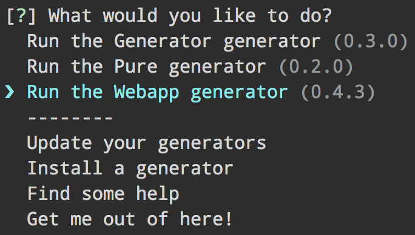

# yo [](http://badge.fury.io/js/yo) [](https://github.com/yeoman/yo/actions/workflows/ci.yml) [](https://coveralls.io/r/yeoman/yo) [](https://www.youtube.com/watch?v=9auOCbH5Ns4) [](https://gitter.im/yeoman/yeoman) [](https://opencollective.com/yeoman#support)

[](http://yeoman.io)




## What's Yeoman?

Yeoman helps you to kickstart new projects, prescribing best practices and tools to help you stay productive.

To do so, we provide a [generator ecosystem](http://yeoman.io/generators/). A generator is basically a plugin that can be run with the `yo` command to scaffold complete projects or useful parts.


## Usage

```sh
# install yo
npm install --global yo

# install a generator
npm install --global generator-webapp

# run it
yo webapp
```

or via `brew`:

```sh
brew install yo
```

*To create and distribute your own generator, refer to [our official documentation](http://yeoman.io/authoring/)*

You can also run a local generator on your computer as such:

```sh
# Running a local generator
yo ./path/to/local/generator
```

## Options

- `--no-color` - Disable colors.
- `--version` - Print the current `yo` version.
- `--help` - Print `yo` help menu with the list of found generators.
- `--generators` - Print available generators.
- `--local-only` - Disable lookup of globally-installed generators.


## Version compatibility

- `yo` is the command-line interface.
- `yeoman-environment` discovers, loads, and runs generators.
- `yeoman-generator` provides the base class and helpers for writing generators.

The table shows the Node.js engine and `yeoman-environment` dependency ranges declared in the [published `yo` manifests](https://registry.npmjs.org/yo). Individual generators can have additional requirements.

| `yo` release | Node.js (`engines.node`) | `yeoman-environment` dependency |
| --- | --- | --- |
| 3.0.0, 3.1.0, 3.1.1 | `>=8` | `^2.4.0` |
| 4.0.0 | `>=12.10.0` | `~3.2.0` |
| 4.1.0 | `>=12.10.0` | `~3.3.0` |
| 4.2.0 | `>=12.10.0` | `~3.4.0` |
| 4.3.0, 4.3.1 | `>=12.10.0` | `^3.5.1` |
| 5.0.0 | `^18.17.0 \|\| >=20.5.0` | `^4.0.0` |
| 5.1.0 | `^18.17.0 \|\| >=20.5.0` | `^4.4.3` |
| 6.0.0 | `^20.17.0 \|\| >=22.9.0` | `^5.0.0` |
| 7.0.0 | `^20.17.0 \|\| >=22.9.0` | `^6.0.0` |
| 7.0.1 | `^20.17.0 \|\| >=22.9.0` | `^6.0.1` |

To check a specific generator release, inspect its Node.js engine and the ranges in its dependencies and peer dependencies.

```sh
npm view generator-webapp@3.0.1 engines dependencies peerDependencies
```

Replace `generator-webapp@3.0.1` with the package and version you plan to use. Look for `yeoman-generator` and `yeoman-environment` in the output. If the generator depends on `yeoman-generator`, check that package's Node.js and environment requirements too.


## Troubleshooting

Running `yo doctor` command can help you troubleshoot common issues.

If `doctor` doesn't help, then check opened issues for a similar problem. Open a new issue if your problem haven't been reported yet. Make sure to always include the version of `yo` (`yo --version`) and Node.js (`node --version`) you use.

If your issue only occurs using a generator, please report the issues on the generator's repository.


## Contribute

See the [contributing docs](http://yeoman.io/contributing/).


## Changelog

See the [release page](https://github.com/yeoman/yo/releases).


## Backers
Love Yeoman work and community? Help us keep it alive by donating funds to cover project expenses! <br />
[[Become a backer](https://opencollective.com/yeoman#support)]

  <a href="https://opencollective.com/yeoman/backers/0/website" target="_blank">
    
  </a>
  <a href="https://opencollective.com/yeoman/backers/1/website" target="_blank">
    
  </a>
  <a href="https://opencollective.com/yeoman/backers/2/website" target="_blank">
    
  </a>
  <a href="https://opencollective.com/yeoman/backers/3/website" target="_blank">
    
  </a>
  <a href="https://opencollective.com/yeoman/backers/4/website" target="_blank">
    
  </a>
  <a href="https://opencollective.com/yeoman/backers/5/website" target="_blank">
    
  </a>
  <a href="https://opencollective.com/yeoman/backers/6/website" target="_blank">
    
  </a>
  <a href="https://opencollective.com/yeoman/backers/7/website" target="_blank">
    
  </a>
  <a href="https://opencollective.com/yeoman/backers/8/website" target="_blank">
    
  </a>
  <a href="https://opencollective.com/yeoman/backers/9/website" target="_blank">
    
  </a>
  <a href="https://opencollective.com/yeoman/backers/10/website" target="_blank">
    
  </a>
  <a href="https://opencollective.com/yeoman/backers/11/website" target="_blank">
    
  </a>
  <a href="https://opencollective.com/yeoman/backers/12/website" target="_blank">
    
  </a>
  <a href="https://opencollective.com/yeoman/backers/13/website" target="_blank">
    
  </a>
  <a href="https://opencollective.com/yeoman/backers/14/website" target="_blank">
    
  </a>
  <a href="https://opencollective.com/yeoman/backers/15/website" target="_blank">
    
  </a>
  <a href="https://opencollective.com/yeoman/backers/16/website" target="_blank">
    
  </a>
  <a href="https://opencollective.com/yeoman/backers/17/website" target="_blank">
    
  </a>
  <a href="https://opencollective.com/yeoman/backers/18/website" target="_blank">
    
  </a>
  <a href="https://opencollective.com/yeoman/backers/19/website" target="_blank">
    
  </a>
  <a href="https://opencollective.com/yeoman/backers/20/website" target="_blank">
    
  </a>
  <a href="https://opencollective.com/yeoman/backers/21/website" target="_blank">
    
  </a>
  <a href="https://opencollective.com/yeoman/backers/22/website" target="_blank">
    
  </a>
  <a href="https://opencollective.com/yeoman/backers/23/website" target="_blank">
    
  </a>
  <a href="https://opencollective.com/yeoman/backers/24/website" target="_blank">
    
  </a>
  <a href="https://opencollective.com/yeoman/backers/25/website" target="_blank">
    
  </a>
  <a href="https://opencollective.com/yeoman/backers/26/website" target="_blank">
    
  </a>
  <a href="https://opencollective.com/yeoman/backers/27/website" target="_blank">
    
  </a>
  <a href="https://opencollective.com/yeoman/backers/28/website" target="_blank">
    
  </a>
  <a href="https://opencollective.com/yeoman/backers/29/website" target="_blank">
    
  </a>


## License

BSD-2-Clause © Google
